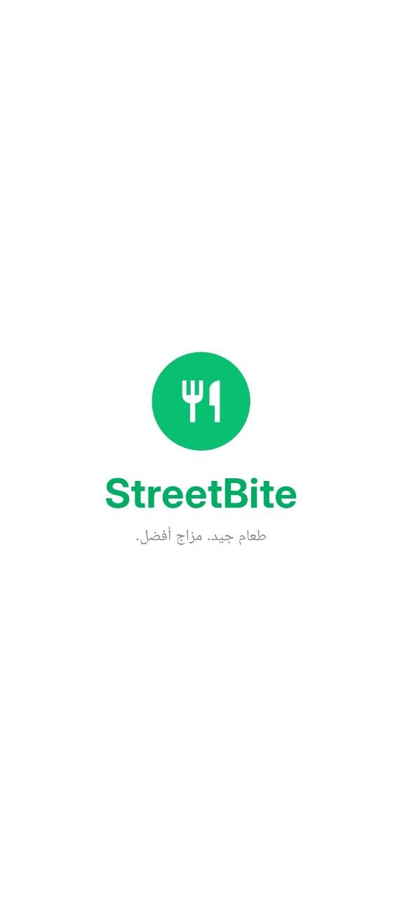
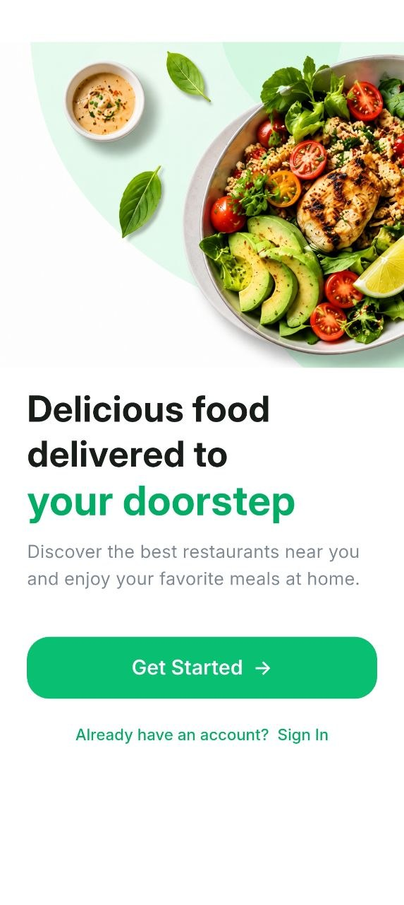
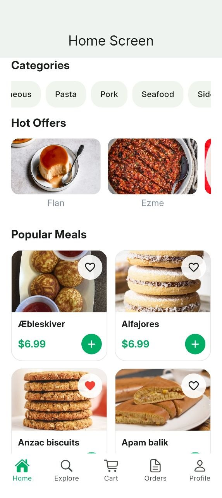
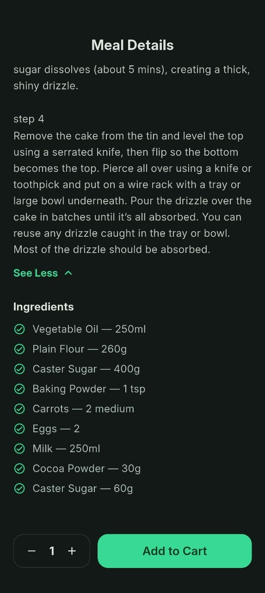
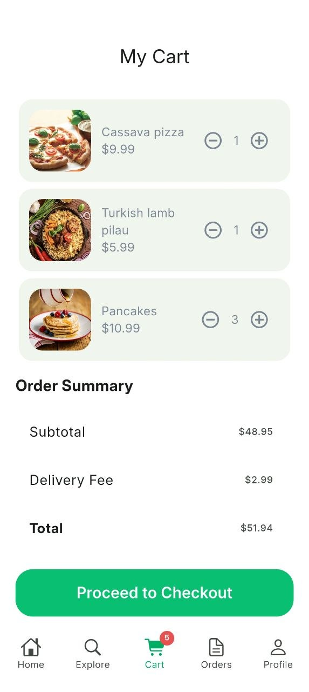
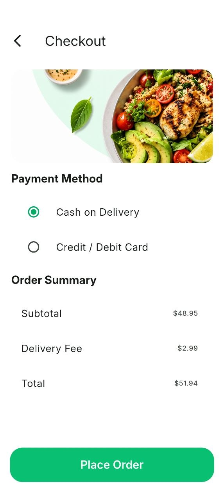
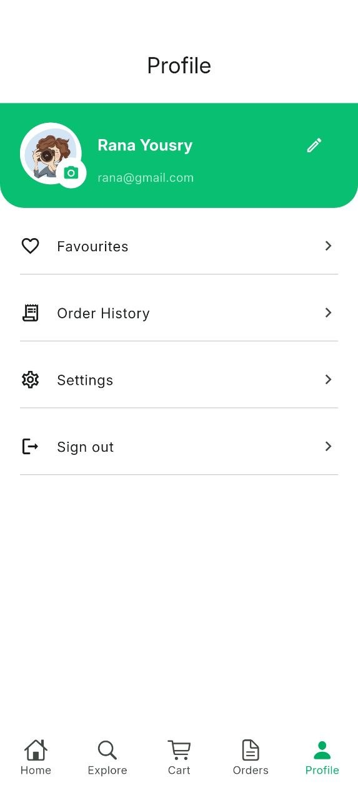
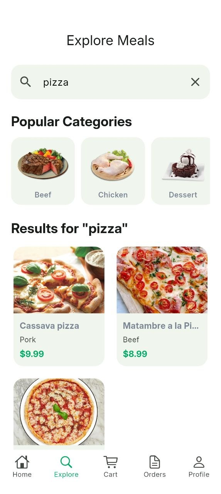

# StreetBite 🍽️

**StreetBite** is a Flutter mobile application for discovering meals, exploring recipes, managing favourites and a shopping cart, and placing orders with cash on delivery or Stripe card payments in test mode. It uses TheMealDB for meal information and Firebase for authentication and application data.

**Version:** 1.0.0+1  
**Platform:** Android (Flutter mobile app)  
**Project type:** Graduation project

## Features

- **Authentication:** Sign up, sign in, input validation, and profile management using Firebase Authentication.
- **Home:** Meal categories, popular meals, and promotional offers.
- **Explore & Search:** Search meals and filter by category; horizontally scrollable category list.
- **Meal Details:** Images, ingredients/description and preparation instructions.
- **Favourites:** Save and manage favourite meals with Firestore.
- **Cart & Checkout:** Add or remove meals, update quantities, review totals, and choose Cash on Delivery or card payment via Stripe Payment Sheet (test mode).
- **Orders:** Save orders to Cloud Firestore and view order history with payment method and order status. Stripe card orders can store the PaymentIntent reference and payment status.
- **Nearby Vendors:** View vendor locations on Google Maps and tap markers for details.
- **Profile & Settings:** Profile editing, biometric authentication, device information, and app preferences.
- **Localization:** English and Arabic with RTL support.
- **Appearance:** Light and dark themes.

## Tech Stack

| Area | Technology |
| --- | --- |
| App | Flutter, Dart |
| Architecture | Layered/Clean Architecture, repository and use-case patterns |
| State management | BLoC / Cubit |
| Dependency injection | GetIt |
| Backend | Firebase Authentication, Cloud Firestore |
| Networking | Dio, Retrofit |
| Test card payments | flutter_stripe, Stripe Payment Sheet (test mode only) |
| Serialization | json_serializable, build_runner |
| Meal data | TheMealDB API |
| Maps | Google Maps Flutter |
| Local preferences | shared_preferences |
| Device security | local_auth |
| UI localization | Flutter gen-l10n |
| Automation | Appium, Java 17, TestNG, Maven, UiAutomator2 |

## Project Structure

```text
food_delivery/
├── lib/
│   ├── core/                # Shared services, helpers, routing and widgets
│   ├── data/                # Models, data sources and repositories
│   ├── domain/              # Domain logic and use cases
│   ├── presentation/        # Screens, BLoC/Cubit and UI widgets
│   └── l10n/                # Localization resources
├── docs/screenshots/        # Stripe test-flow screenshots
├── assets/                  # Images and fonts
├── automation/
│   ├── src/test/java/       # Appium/TestNG test classes
│   ├── pom.xml              # Maven dependencies and test runner
│   └── testng.xml           # Final 10-test suite
├── StreetBite Manual QA/    # Manual test results and closure report
└── ScreenShots/             # App, QA and automation evidence
```

## Running the Flutter App

### Prerequisites

- Flutter SDK compatible with the project's Dart SDK constraint (`^3.13.5`).
- Android SDK and a connected Android device or emulator.
- A Firebase project configured for the Android application.
- Google Maps Android API key configured for the target environment.
- Internet access for meal images, meal API requests, Firebase, and maps.

### Setup

```bash
flutter pub get
flutter gen-l10n
flutter run
```

If generated Retrofit or JSON files need regeneration:

```bash
dart run build_runner build --delete-conflicting-outputs
```

Firebase and Google Maps configuration must be supplied for the environment. Do not commit private credentials or service-account keys. The Android application ID used by the automation suite is `com.example.food_delivery`.

### Stripe card payment (TEST MODE ONLY)

StreetBite integrates **Stripe Payment Sheet** for test card payments on Android. The checkout supports **Cash on Delivery** and **Credit / Debit Card**. The card flow creates a test PaymentIntent, displays the Stripe-hosted Payment Sheet, checks the returned payment status, and then attempts to save the order in Firestore. Cash on Delivery does not require Stripe.

> **Security limitation:** This graduation-project test build currently calls Stripe's PaymentIntents API directly from the mobile app using a **test secret key**. This is **not safe for production**: `--dart-define`, CI/CD variables and `.gitignore` do not make a secret embedded in an APK secure. Use only `sk_test_` credentials; never embed `sk_live_` or process real payments this way. Before production, move PaymentIntent creation and payment/order verification to a trusted backend and use webhooks/idempotency.

Create a local `stripe_test.json` alongside `pubspec.yaml` (do **not** commit this file):

```json
{
  "STRIPE_PUBLISHABLE_KEY": "pk_test_REPLACE_WITH_YOUR_TEST_KEY",
  "STRIPE_TEST_SECRET_KEY": "sk_test_REPLACE_WITH_YOUR_TEST_KEY"
}
```

Add `stripe_test.json` to `.gitignore`, and run on a connected **Android** device:

```powershell
flutter pub get
flutter gen-l10n
flutter devices
flutter run -d YOUR_ANDROID_DEVICE_ID --dart-define-from-file=stripe_test.json
```

The currently tested Android device was a Realme RMX3840 (Android 16). **Chrome/web is not a supported target for this Android-oriented Stripe setup** and can raise `MissingPluginException` on `flutter.stripe/payments`.

For a successful test card, use Stripe's official number `4242 4242 4242 4242`, any future expiration (e.g. `12/30`) and any three-digit CVC (e.g. `123`). Test declined payments with `4000 0000 0000 0002`. See [Stripe test cards](https://docs.stripe.com/testing).

**Verification checklist:** Confirm that Payment Sheet opens, card payment completes, Stripe Dashboard (test mode) shows `Succeeded`, and a matching order is stored in Firestore with the expected amount and payment reference. Also test cancellation, declined cards and Cash on Delivery. A screenshot of the Payment Sheet or a pending order **does not on its own prove a successful charge**.

### Build an Android release APK

```bash
flutter build apk --release
```

The output is located at:

```text
build/app/outputs/flutter-apk/app-release.apk
```

**Distribution:** Version 1.0.0 was built and distributed for evaluation through Firebase App Distribution to two invited testers. Distribution access is controlled in Firebase; the APK is not publicly hosted in this repository.

## Quality Assurance

### Manual Testing

Manual testing covered authentication, navigation, meal discovery, favourites, cart, checkout, settings, localization, connectivity and mobile usability.

| Result | Count |
| --- | ---: |
| Test cases | 76 |
| Passed | 71 |
| Failed | 5 |
| Pass rate | 93.4% |

The manual testing spreadsheet and test closure report are in [`StreetBite Manual QA/`](StreetBite%20Manual%20QA/). Known issues are documented in the QA artifacts; a successful automation run does not mean all manual defects are resolved.

### Appium Automation

The Android automation suite is implemented using **Java 17 + Appium + TestNG + Maven**. The final suite contains **10 tests**, all of which passed in the final local run.

| ID | Automated test | Result |
| --- | --- | --- |
| AUTO-01 | Valid login | Pass |
| AUTO-02 | Invalid login | Pass |
| AUTO-03 | Empty login | Pass |
| AUTO-04 | Home scrolling | Pass |
| AUTO-05 | Add a meal to cart | Pass |
| AUTO-06 | Search for a meal | Pass |
| AUTO-07 | Open meal details | Pass |
| AUTO-08 | Bottom navigation | Pass |
| AUTO-09 | Remove a meal from cart | Pass |
| AUTO-10 | Filter meals by category | Pass |

**Final result: 10 tests passed, 0 failures, 0 errors, 0 skipped.**

#### Automation prerequisites

1. Install **JDK 17**, **Maven**, **Node.js**, and **Appium**.
2. Install the Appium UiAutomator2 driver:

   ```bash
   appium driver install uiautomator2
   ```

3. Connect an Android phone with USB debugging enabled, then check:

   ```bash
   adb devices
   ```

4. Install and open the StreetBite Android app. Ensure the phone has internet access and is set to English for the existing accessibility locators.
5. Review `automation/src/test/java/BaseTest.java` and replace the development device's hard-coded `deviceName` and `udid` with your device ID from `adb devices`. The suite currently expects package `com.example.food_delivery` and activity `com.example.food_delivery.MainActivity`.
6. Before the full suite, sign out and navigate to the **Login** screen. Use a dedicated test account; never put passwords in source control.

#### Run all automation tests (Windows PowerShell)

Start Appium in a separate terminal:

```powershell
appium
```

In a second terminal, from the project root:

```powershell
cd automation
$env:TEST_EMAIL = "your-test-email@example.com"
$env:TEST_PASSWORD = "your-test-password"
mvn clean test
```

The tests connect to Appium at `http://127.0.0.1:4723`. Maven Surefire uses [`automation/testng.xml`](automation/testng.xml) to run the final suite in order. Test reports are generated under `automation/target/surefire-reports/` (a generated directory that should not be committed).

**Notes:** The test suite uses `noReset=true`, so the app retains its session between test methods. The login tests expect the app to start at Login; later tests use the authenticated session. Credentials are read from `TEST_EMAIL` and `TEST_PASSWORD` environment variables.

### Test Evidence

| Evidence | Screenshot |
| --- | --- |
| Automation summary |  |
| Login tests |  |


## App Screenshots

| Splash | Onboarding | Login |
|:---:|:---:|:---:|
|  |  |  |

| Home | Meal Details | Ingredients |
|:---:|:---:|:---:|
|  |  |  |

| Cart | Checkout | Payment |
|:---:|:---:|:---:|
|  |  |  |

| Profile | Favourites | Settings |
|:---:|:---:|:---:|
|  |  |  |

| Nearby Vendors | Order History | Search |
|:---:|:---:|:---:|
|  |  |  |

The full app UI and QA evidence are stored separately in the project's `ScreenShots/` folder in the submission repository. Keep the existing Home, Explore, Cart, Profile, Checkout, Nearby Vendors, localization and QA screenshots there.

## Project Notes

- Designed as a **mobile-first** Flutter project.
- Meal data and images require an internet connection.
- Stripe card payments run in **test mode** only; no live payment processing is claimed. Vendor listings are demonstration data.
- Stripe test integration was exercised on Android; Stripe Dashboard confirmation and a matching Firestore order should be checked before claiming a fully verified payment.
- The README documents the project's final tested Android configuration; adapting Appium to a different device requires changing the test device capabilities.

## Developer

**Fatma Atef** — Junior Flutter Developer  
[GitHub](https://github.com/fatima304) · [LinkedIn](https://www.linkedin.com/in/fatmaatef11)
